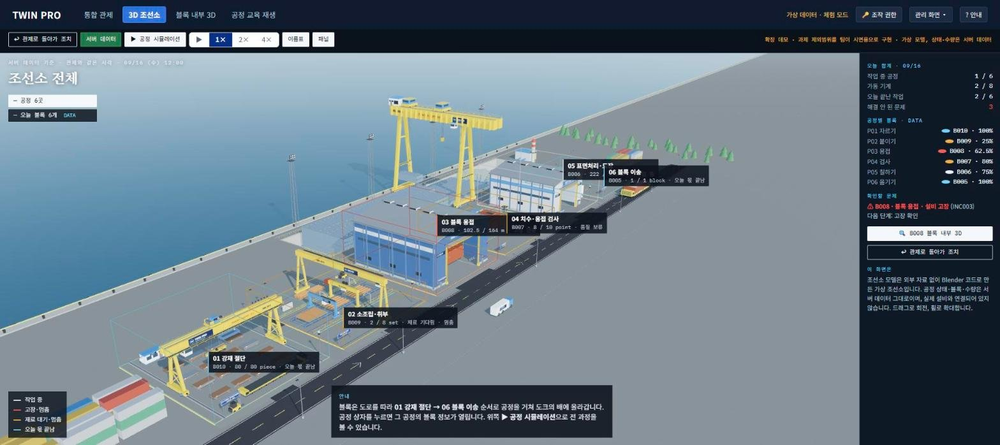
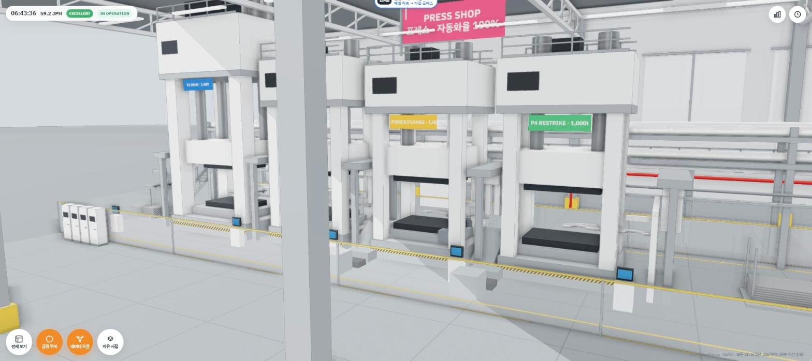
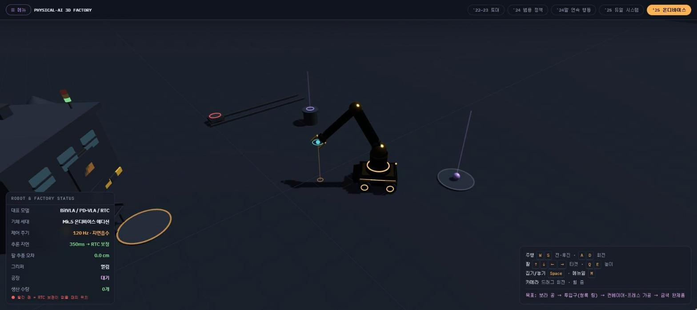
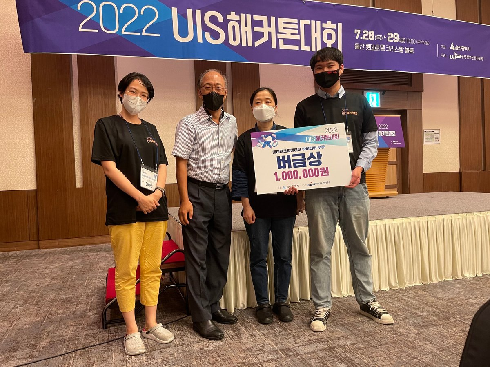
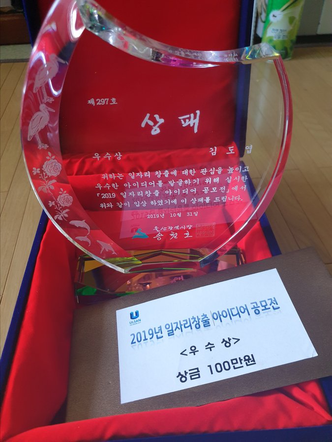

## 김도엽 · Kim Doyeop

상수도 SCADA/HMI · 디지털 트윈 · 사내 업무 시스템을 설계부터 납품까지 직접 만드는 개발 PM입니다.

- **현장에서 화면까지**: 통신 게이트웨이 프로토콜 · 태그 주소 체계 · 수집기 · DB · 운영 화면 · 보고서를 한 흐름으로 구현
- **문서와 시제품을 함께**: 기능명세서 · 화면 설계(Figma) · 공공 조달 문서와 실제로 돌아가는 시제품을 같이 만듦

### 기술

| 분야 | 사용 |
|---|---|
| 산업용 · 데스크톱 | C# · .NET 10 · WPF, SQLite, ETOS 게이트웨이 FEnet 통신, SCADA/HMI(CIMON) |
| 웹 · 업무 시스템 | TypeScript · React · Vite · shadcn/ui, Supabase(PostgreSQL · Edge Functions), PHP · PostgreSQL · Oracle |
| 3D · 디지털 트윈 | Three.js · WebGL · glTF |
| 데이터 · 자동화 | Python, SQL, Excel 자동화, Playwright |
| 설계 · 문서 | Figma, 기능명세서 · 기능점수(FP) · 제안서 · HWPX |

### 🔒 보안 프로젝트

> 고객사 · 사내 보안 과제라 저장소를 비공개로 두었습니다. 코드 · 화면 · 설비 정보는 공개하지 않고 범위와 기술만 적습니다.

| 프로젝트 | 내용 | 기술 |
|---|---|---|
| **상수도 5개 사업소 통합감시 · 제어 시스템** | 가압장 · 배수지 원격 감시 · 제어 프로그램. 통신 게이트웨이 프로토콜 직접 구현, 태그 8,600여 개 수집 · 경보 · 트렌드 · 보고서(일 · 주 · 월 · 연보) · 감사 로그 · 원격 제어(확인 창 · 결과 확인). 관리자 모드에서 화면을 바로 편집(도면 편집기 · 보고서 작화 · 트렌드 그룹). Python 시제품을 C#으로 이식 — 소스 3.6만 줄 · 단위시험 329건 | C# · .NET 10 · WPF · SQLite · Python |
| **상수도 유량감시 시스템** | 유량계 · 수압계 262곳을 1분마다 수집해 순시 · 적산 · 압력을 실시간 관제 · 그래프 · 일보 · 월보 · 연보로 제공. 수집기와 조회 프로그램을 나누고 현장 PLC 제조사별 데이터 해석 규칙을 실측 검증, 1분 기록 · 현재값 · 시간 · 일 요약 구조로 5년 약 10억 행 규모 설계 | PHP · PostgreSQL · Oracle |
| **HIET ERP — 사내 업무 시스템** | 근태(지문인식기 연동) · 결재 · 프로젝트 · 개발팀 일지 · 주간보고 · 단가 관리 · 계측기 관리 · 안전교육 · 메신저 · 게시판. 화면 60여 개 · 서버 함수 15개 | React · TypeScript · Supabase |

### 수주 실적

| 연도 | 사업 | 금액 |
|---|---|---|
| 2026 | 5개 사업소 통신 사업 | 2.5억 원 |
| 2025 | 유량계 사업 — 제안 수주 | 1.5억 원 |
| 2025 | 유지보수 사업 | 2.6억 원 |

### 공개 프로젝트 — [develop-korea-tech](https://github.com/develop-korea-tech)

| 프로젝트 | 내용 | 기술 |
|---|---|---|
| [TWIN PRO 운영 모니터링](https://github.com/develop-korea-tech/twinpro-demo) · [▶ 데모](https://develop-korea-tech.github.io/twinpro-demo/) · [▶ 소개 영상](https://develop-korea-tech.github.io/twinpro-demo/media/twinpro-intro-2026-10-18.mp4) | 조선 블록 제작 공정 운영 모니터링 시연 — 관제 · 관리 화면 5개와 3D 화면(조선소 · 블록 내부 · 공정 교육 재생), Supabase 테이블 24개 · 서버 함수 14개 · AI 운영 요약 (울산 청년 AX 리더십 팀 과제) | JavaScript · Supabase · Three.js |
| [EV 차체 · 조립 공장 디지털 트윈](https://github.com/develop-korea-tech/twin-demo) · [▶ 데모](https://develop-korea-tech.github.io/twin-demo/) | 프레스 → 차체 → 도장 → 의장 공장 3D 트윈, 구역별 자동화율 · AI 도입 전후 비교 | Three.js |
| [Physical AI 3D Factory](https://github.com/develop-korea-tech/physical-ai-sim) · [▶ 데모](https://develop-korea-tech.github.io/physical-ai-sim/) | 모바일 로봇 자동화 공장 3D 시뮬레이션 · 피지컬 AI 발전사 페이지 | Three.js |
| [Mythos Survivors](https://github.com/develop-korea-tech/mythos_survivors) · [▶ 데모](https://develop-korea-tech.github.io/mythos_survivors/) | 각국 설화 영웅 6명의 서바이벌 웹게임 — 스테이지 3개 · 영웅별 무기 각성 · 모바일 지원 | JavaScript · Canvas |
| [고양이 vs 집사](https://github.com/develop-korea-tech/yaong) · [▶ 데모](https://develop-korea-tech.github.io/yaong/) | 유저가 고양이(침입자), AI 집사가 막는 역술래 게임 — 1단계 프로토타입, 스테이지 10개 | JavaScript · Canvas |
| [Hotel Carta — 잊은 것들의 밤](https://github.com/develop-korea-tech/bitdata-hotel) · [▶ 데모](https://develop-korea-tech.github.io/bitdata-hotel/) | 빅데이터분석기사 1과목 개념을 3D 호텔 탐색 · 자물쇠 퍼즐로 외우는 게임 — 문서 90개 · 문항 116개 | JavaScript · Three.js |
| [태산그룹 막내아들](https://github.com/develop-korea-tech/bitdata) · [▶ 데모](https://develop-korea-tech.github.io/bitdata/) | 빅데이터분석기사 필기 학습 RPG — 21화 스토리 · 4지선다 설전 170문항(해설 포함) | JavaScript |
| [가족 같은 회사 — 채용 기록](https://github.com/develop-korea-tech/menhera) · [▶ 데모](https://develop-korea-tech.github.io/menhera/) | 공포 연출 인터랙티브 웹 페이지 | HTML · JavaScript |
| [모바일 청첩장](https://github.com/develop-korea-tech/wedding) | 지인 의뢰 모바일 청첩장 — 사진 갤러리 · 배경음악 · 카카오톡 공유 카드 | HTML · JavaScript |

#### 디지털 트윈 · 3D 화면

  
  
  
  

위: TWIN PRO 3D 조선소 · 블록 내부 / 아래: EV 차체 공장 프레스 · Physical AI 로봇 시뮬레이터 — 그림을 누르면 데모가 열립니다.

### 수상

| 연도 | 대회 | 결과 | 주최 |
|---|---|---|---|
| 2022 | UIS 해커톤대회 — 데이터크리에이터 아이디어 부문(데이터 관련 아이디어 코딩) | 버금상(2등) | 울산광역시 · 울산정보산업진흥원 |
| 2022 | 청년 아이디어 PT 대회 | 장려상 | 경상일보 |
| 2020 | 경상일보 PT 대회 | 우수상 | 경상일보 |
| 2019 | 일자리창출 아이디어 공모전 | 우수상 | 울산광역시 |
| 2019 | 청년 아이디어 해커톤 — 청년 정책 아이디어 | 대상 | 울산청년센터 |

  
  

왼쪽: 2022 UIS 해커톤대회 버금상 · 오른쪽: 2019 일자리창출 아이디어 공모전 우수상

### 활동

- 2021.09 ~ 2021.12 · 공공데이터 청년인턴 — 데이터 개념 정리

### 학습 기록 (2023 ~ 2024)

[Javaworkshop](https://github.com/kimdoyeop1/Javaworkshop) · [JAVAProject](https://github.com/kimdoyeop1/JAVAProject) · [BackEnd](https://github.com/kimdoyeop1/BackEnd) · [game](https://github.com/kimdoyeop1/game) — Java · 웹 기초 실습
