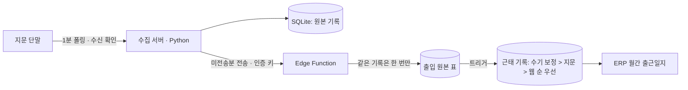

# 지문인식 근태 단말 연동

| 항목 | 내용 |
|---|---|
| 기간 | 2026-09 |
| 역할 | 단말 통신 분석, 수집 서버 개발, 사내 ERP 연동 |
| 기술 | Python(소켓 서버 · SQLite), Wireshark, Supabase(Edge Function · PostgreSQL 트리거) |

## 1. 해결할 문제

사내 지문인식 근태 단말의 출퇴근 기록을 사내 ERP(웹, Supabase)에 자동으로 넣어야 했습니다. 제조사 통신 문서가 없고, 단말은 표준 근태 프로토콜을 쓰지 않았습니다.

## 2. 분석 과정

| 단계 | 확인한 것 |
|---|---|
| 포트 조사 | 단말이 여는 포트가 하나뿐이고 표준 근태 프로토콜 포트가 아님 |
| 직접 대기(리스너) | 단말이 서버에 접속은 하지만 먼저 보내지 않음 → 서버가 묻는 방식 |
| 패킷 캡처 | 제조사 프로그램의 통신을 Wireshark로 캡처해 세션 시작 · 단말 정보 · 명부 조회 · 기록 수집 · 수신 확인 순서와 레코드 구조를 해독 |
| 직접 통신 | 제조사 프로그램 없이 자체 코드로 명부(60여 명) 조회와 기록 수집에 성공 |

## 3. 구조

## 4. 핵심 설계 결정

| 결정 | 이유 |
|---|---|
| 단말 원본 기록을 먼저 로컬 SQLite에 저장하고, 전송 여부를 따로 표시 | 인터넷이 끊겨도 기록을 잃지 않고 나중에 이어 보냄 |
| 서버 쪽은 같은 기록이 두 번 와도 한 번만 반영(멱등) | 재전송 · 중복 수집에 안전 |
| 원본 표와 근태 표를 나누고 트리거로 반영, 수기 보정을 지문보다 우선 | 관리자가 고친 값을 단말 기록이 덮어쓰지 않게 |
| 수집 서버를 단말과 같은 사내망 상시 PC에 배치 | 다른 망의 서버와 사내 NAS는 망 분리 · 방화벽 때문에 단말 또는 클라우드에 닿지 못함을 현장에서 확인 |

## 5. 검증

실제 지문 1회가 단말 → 수집 서버 → Supabase → ERP 월간 출근일지까지 반영되는 것을 확인했습니다. 연동 중 ERP 쪽 날짜 변환 버그(HTTP 500)를 찾아 수정했습니다.

## 6. 공개하지 않은 것

제조사 명령 코드 · 패킷 형식, 단말 고유 정보, 사내 네트워크 주소, 인증 키, 소스 코드.
