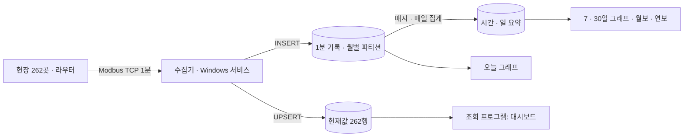

# 상수도 유량감시 수집 · DB 설계

| 항목 | 내용 |
|---|---|
| 기간 | 2025 ~ 2026 |
| 역할 | 제안 · 수주, 현장 통신 검증, 수집기 · DB 설계와 구현 |
| 규모 | 유량계 · 수압계 262곳, 1분 주기, 기존 약 3억 행 + 5년 약 6.9억 행 → 약 10억 행 |
| 기술 | Modbus TCP, C# · .NET 8(Worker Service) · Npgsql, PostgreSQL. 기존 운영 시스템은 PHP · PostgreSQL · Oracle |

## 1. 해결할 문제

현장 라우터를 교체한 뒤, 유량계마다 순시 유량 · 적산 유량 · 압력을 1분마다 모아 실시간 관제와 일보 · 월보 · 연보를 만들어야 했습니다. 현장 PLC 제조사가 셋이라 같은 값이라도 레지스터 위치 · 워드 순서 · 배율이 서로 달랐습니다.

## 2. 구조

- 수집 · 처리기와 조회 프로그램을 나눴습니다. 수집기는 무인으로 상시 돌아야 해서 Windows 서비스로, 조회는 데스크톱 앱으로 만들었습니다.
- 화면마다 읽는 표를 정했습니다. 대시보드는 현재값(262행)만, 오늘 그래프는 1분 기록, 기간 그래프와 보고서는 요약 표를 읽습니다. 10억 행 표를 화면이 직접 훑지 않게 하기 위해서입니다.

## 3. 핵심 설계 결정

| 결정 | 이유 |
|---|---|
| Modbus TCP 읽기(FC03) 프레임을 라이브러리 없이 직접 구현 | 현장 PC에 외부 패키지를 설치하기 어렵고, 장애 시 바이트 단위로 원인을 볼 수 있어야 함 |
| "접속 정보 + 값 해석 규칙(디코더)"을 프로파일로 분리 | 제조사가 다르면 해석 규칙만 바꿔 끼움. 제조사 3종의 규칙(레지스터 위치 · UInt32/Int32 · 배율 0.1/0.01/0.001)을 현장 실측으로 검증 |
| 1분 기록은 월별 파티션(5년치 65개 미리 생성) | 오래된 데이터 삭제 · 보관을 파티션 단위로 처리 |
| 읽기 실패는 0이 아니라 빈 값 + 품질 코드 | 보고서 합계가 틀어지지 않게, 통신 두절과 실제 0을 구분 |
| 현재값 갱신에 시각 역행 방지 조건 | 재시도로 늦게 들어온 값이 최신값을 덮지 않게 |
| 분 정각 폴링, 동시 25곳 · 재시도 1회 | 262곳을 1분 안에 끝내면서 라우터 부하를 제한 |

## 4. 검증

- 수집 코어 셀프테스트 76개 단언(assertion) 통과, 현장 Windows에서 빌드 · 테스트 통과.
- DB 설치 스크립트는 반복 실행해도 같은 결과(멱등)이고 Linux PostgreSQL 16과 현장 Windows에서 점검 6항목(파티션 수, 시간대, 쓰기 권한 등)을 확인했습니다. 현장에서 발견한 문제(설치된 PostgreSQL 버전을 못 찾음, 콘솔 한글 깨짐)는 설치 스크립트를 고쳐 다시 배포했습니다.
- 수집기는 검증 현장 3곳으로 24시간 시운전 후 확대하는 순서로 진행합니다.

## 5. 공개하지 않은 것

현장 이름과 위치, IP 목록, 레지스터 주소 상세, DB 계정, 소스 코드.
