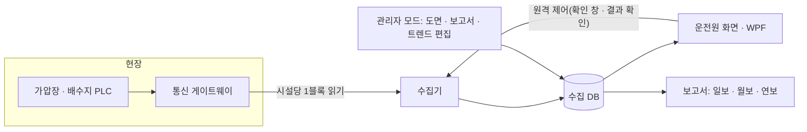

# 상수도 통합감시 · 제어 시스템

| 항목 | 내용 |
|---|---|
| 기간 | 2026 ~ 진행 중 |
| 역할 | 기능 설계(기능명세서) · 메모리 주소 체계 · 수집기 개발, 화면 담당 신입 개발자 업무 지시 · 검토 |
| 규모 | 5개 사업소, 가압장 · 배수지 137개소, 태그 7,989개, 기존 HMI 도면 98개 이관, 기능명세서 v6.0 |
| 기술 | C# · .NET 10 · WPF, SQLite(수집 기록, 이후 PostgreSQL 전환 예정), Python(시제품 · 시뮬레이션) |
| 산업 통신 | 통신 게이트웨이(LS XGT FEnet 계열 프로토콜) 직접 구현, PLC 메모리(%MW) 읽기 · 쓰기 |

## 1. 해결할 문제

기존 상용 SCADA(HMI) 화면으로 운영하던 5개 사업소 원격 감시를 자체 프로그램으로 바꾸는 사업입니다. 운전원은 개발 도구에 익숙하지 않은 비개발자라, 설치 후 버튼 한 번으로 감시 · 경보 확인 · 보고서 출력이 되어야 했습니다.

## 2. 구조

- 수집기와 화면은 DB를 공유하는 방식으로 나눴습니다. 수집기는 DB에 쓰기만, 화면은 읽기만 합니다. 두 사람이 병렬로 개발하면서 인터페이스를 테이블 정의 하나로 줄이기 위한 결정입니다.
- 원시 메모리 값 → 태그 정본 → 파생 설정(경보 · 트렌드 · 보고서)은 태그만 참조 → 화면은 자동 생성, 이렇게 메타데이터를 한 방향으로 쌓았습니다. 태그 하나를 고치면 경보 · 보고서 · 화면이 같이 바뀝니다.

## 3. 핵심 설계 결정

| 결정 | 이유 |
|---|---|
| 시설마다 고정 크기 메모리 블록, DI/DO는 비트 묶음, AI/AO는 워드 하나 | 시설이 늘어도 주소를 계산식으로 구할 수 있고, 읽기 요청을 시설당 1번으로 줄일 수 있음 |
| 주소가 이어지는 시설은 한 번 읽기 한계(700워드) 안에서 한 요청으로 묶어 읽기 | 수집 1사이클 요청 수 142번 → 53번. 묶은 구간에 오류가 나면 그 묶음만 시설별로 다시 읽음 |
| 태그 문자열 분해는 앞뒤를 고정한 정규식, 태그 조회는 (워드, 비트) → 정수 ID 메모리 사전 | 원본 태그 문서에 장치 코드 불일치 · 중복 · 빈 주소가 있어 규칙에 안 맞는 태그는 격리 목록으로 분리 |
| AI는 1분 스냅숏, DI/DO는 변화가 있을 때만 저장 | 저장량을 연 수십 GB 수준으로 묶기 위해 |
| 경보는 연속 2회 판정, 통신 두절 후 복귀는 연속 3회 정상부터 | 순간 튐 · 통신 흔들림에 따른 경보 남발 방지 |
| 경보 등급 1~5를 위험 · 경계 · 주의 3단계로 묶고, 헤더 칩은 시설 수 기준 | 운전원이 한눈에 "몇 곳이 위험한가"를 보도록 |
| 화면 설계(Figma)와 프로그램이 다르면 프로그램을 기준으로 설계서를 고침 | 운영 화면을 실제로 써 본 피드백이 설계서보다 정확해서 |

## 4. 설계를 숫자로 검산한 과정

코드를 쓰기 전에 Python 시뮬레이터(137개소 · 태그 7,616개 · 10초 주기 · 24시간 · 시나리오 8건)로 데이터 흐름을 돌려 설계를 검산했습니다.

| 발견 | 처리 |
|---|---|
| 통신 블록을 4구간으로 나누면 요청 554번 ≈ 8.3초로 10초 주기에 아슬아슬함 | 시설당 1구간으로 바꿔 요청 143번 ≈ 2.1초 |
| 같은 이름의 다른 신호(예: 수위 계열 약어와 pH)가 경보 기본값에서 충돌 | 장치명 + 신호 + 단위로 매칭 |
| 저장량 산정이 이전 방식 기준으로 남아 있었음(초당 804행) | 변화 저장 방식 기준으로 다시 산정(초당 184행, 연 약 43GB) |

## 5. 구현 · 검증

- Python 시제품(화면 · 시험 데이터 발생기)으로 운전원 피드백을 먼저 받고, C# WPF로 전면 이식했습니다.
- 경보 · 트렌드 · 보고서(일 · 주 · 월 · 연보) · 감사 로그 · 원격 제어, 관리자 모드의 도면 편집 · 보고서 작화 · 트렌드 그룹 편집을 구현했습니다.
- C# 약 7.1만 줄(본체 4.1만 · 시험 코드 3.0만), 단위시험 1,652건과 UI 동작 시험 4,093건(39묶음)이 모두 통과합니다(2026-11 기준). 빌드 → 단위시험 → UI 동작 시험 → 화면 저장을 스크립트 한 번으로 돌립니다.

## 6. 공개하지 않은 것

시설명 · 위치, 실제 태그명과 주소표, 네트워크 구성, 화면 원본, 소스 코드.
